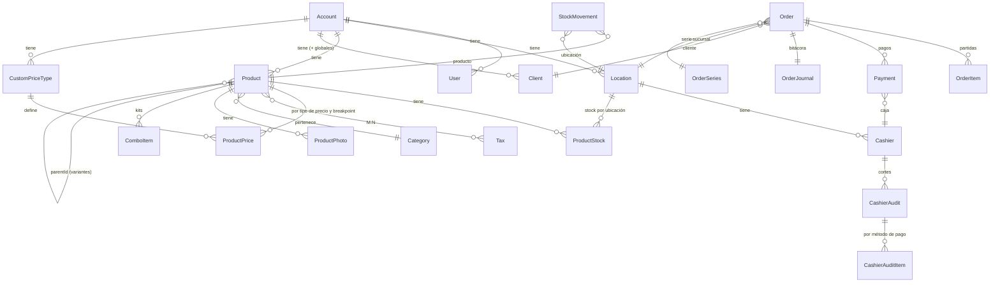

# Análisis del modelo de datos de Pulpos TPV (sin facturación)

Fuente: tráfico del frontend web (`app.pulpos.com`) de una cuenta de prueba nueva, solo lectura/navegación.
Es inferencia a partir de las respuestas JSON; los nombres de tablas reales pueden diferir.

## 1. Arquitectura observada

| Aspecto | Hallazgo |
|---|---|
| Frontend | Next.js (`/_next/data/...`), SPA/SSR. La app Android es un contenedor del mismo sitio. |
| API | **tRPC** sobre HTTP: `GET /api/backend/<router>.<procedimiento>?input={"json":...}` (lecturas) y `POST` (mutaciones). Serialización **superjson** (`meta.values` marca `undefined`, fechas, etc.). |
| Auth | **AWS Cognito** (`cognito-idp.us-east-1`). Login en dos pasos: `auth.getUserByEmail` → `auth.signIn`. `users.openIdSub` = `sub` de Cognito. Proveedores: `PASSWORD`, Google. |
| IDs | **cuid** (`cmv59...`), generados por el servidor/cliente, texto de 25 chars. Además `userFriendlyId` de 7 caracteres para mostrar (`P3UVPEF`). |
| Multi-tenant | Toda tabla lleva `accountId`. Un `Account` = un negocio. |
| Dinero | **Strings decimales** (`"49.98"`) con columna hermana `*Currency` (`"MXN"`). Nunca floats. |
| Borrado | **Soft delete** universal: `deletedAt`. Además `createdAt/updatedAt` y `userIdCreatedBy` en casi todo. |
| Idempotencia/offline | `orders.requestId` (UUID del cliente) + `orders.isOffline`. Una venta offline se encola en el cliente y se reenvía con el mismo `requestId`. |
| Datos de prueba | `isTest` en productos y ventas: la cuenta nueva se siembra con datos demo marcados. |
| Paginación | `pagination: {pageIndex, pageSize}` → respuesta `{data: [...]}`. |
| Otros servicios | Stripe/Chargebee (suscripción), HubSpot (chat), Datadog RUM, hCaptcha, WhatsApp Business, Mercado Pago. |

## 2. Entidades y relaciones

### Núcleo (lo que se necesita para un TPV)

**Account** — negocio. Tiene settings en tablas 1:1 separadas por módulo (`stock.getSettings`, `orders.getSettings`, `quotations.getSettings`, `manufacturing.getSettings`, `accountSettings.*`) en vez de un JSON gigante: `allowMovingNegativeStock`, `allowSellingOutOfStock`, `batchStrategy`, `minProfitMargin`/`minProfitMarginPolicy`, `restrictSellingToClientsWithOverdueDebt`, etc. Los *feature flags* (`MANUFACTURING`, `BANK_RECONCILIATIONS`, `WHATSAPP_SALES_CHANNEL`) se exponen en `getAccountFeatures`.

**User** — `email`, `name`, `surname`, `phoneNumber`, `role` (`ADMIN`…), `isAccountOwner`, `advancedPermissions[]` (permisos finos aparte del rol), `authProviders[]`, `openIdSub`, `defaultPriceTypeId`, `slug`, `tsv` (columna tsvector → **Postgres** con búsqueda full-text).

**Location** — sucursal o almacén: `type: BRANCH | WAREHOUSE`, `isDefault`, `defaultPriceTypeId`, `address`. Tiene `invoicingSettings` propios (omitimos).

**Cashier** (caja física/lógica) — `locationId`, `isDefault`, `orderSeriesId`. Una sucursal tiene N cajas.

**OrderSeries** — serie/folio de ventas; `onlyLocation` limita a una sucursal. `orderNumber` es consecutivo por serie.

**Product** (tabla "perfil")
- `type` (`PRODUCT`, servicio…), `name`, `slug`, `description`, `barcode`, `sku`, `categoryId`, `brandId`.
- `sellUnit` (enum: `UNIT, KIT, BOX, BAG, METER, CENTIMETER, KILOGRAM, GRAM, LITER, MILLILITER, SERVICE, SQUARE_METER, PIECE`).
- Costo: `cost` + `costCurrency` + `costType` (`NET`/gross).
- Flags: `isStockable`, `isSellable`, `isManufactured`, `batchesEnabled`, `prescriptionRequired`, `displayInCatalog`, `hiddenAt`.
- `parentId` → **variantes** como productos hijos (no hay tabla de variantes); `comboItems` → kits; `satCategoryCode` (clave SAT, solo útil si facturas).
- `profileId` = id del perfil: producto y "perfil de producto" comparten identidad (existe una capa que permite versionar/duplicar).

**ProductStock** — una fila por (producto, ubicación): `stockQuantity`, `minStockQuantity`. Se calcula `availableStock = totalStock - committedStock` (apartados/pedidos comprometidos, `committedOrders`).

**StockMovement** — **ledger append-only**: `previousQuantity`, `currentQuantity`, `locationId`, `productProfileId`, `origin` (`ORDER_CREATE`, ajuste, traspaso, compra…), `originId` (id del documento origen), `discriminatorType/Id` (para lotes), `adjustmentReason`. La cantidad en `ProductStock` es un caché del ledger.

**CustomPriceType + ProductPrice** — listas de precios. Hay una `isDefault` ("Precio Público"). `ProductPrice` = (producto, tipo de precio, `breakpoint`, `price`): el `breakpoint` implementa **precios por volumen** ("desde N unidades"). `Client.defaultPriceTypeId`, `Location.defaultPriceTypeId` y `User.defaultPriceTypeId` eligen la lista a aplicar.

**Tax** — catálogo global compartido por todas las cuentas (21 filas): `type` (`VAT`, `ISR`, `IEPS`), `percentage`, `isExempt`, `isWithheld`. Producto↔Tax es M:N.

**Client** — `type` (`GENERAL_PUBLIC` = cliente genérico sembrado y global con `accountId = null`), `name`, `surname`, `phoneNumber`, `email`, `address`, `fiscalProfileId`, `loyaltyPoints`, `totalDebt` (calculado), `aiAgentEnabled`, `lastDebtReminderSentAt`.

**Order** (venta)
- Cabecera: `userFriendlyId`, `orderNumber`, `orderSeriesId`, `locationId`, `clientId`, `sellerId`, `origin` (`POS`, catálogo en línea, WhatsApp…), `madeAt`.
- Montos: `subtotal`, `discounts`, `originalTotal`, `total` (+ currency cada uno), `withTaxes`.
- **Dos máquinas de estado independientes**: `paymentStatus` y `shippingStatus` (ambos `COMPLETED`, …), más `wayOfPayment`, `shippingMethod`.
- Enlaces: `quotationId` (cotización origen), `invoiceId`, `deliveryAddressId`.
- Calculado en lectura: `debt` (saldo pendiente), `refunds[]`.

**OrderItem** (`itemsProduct`) — **snapshot** de la partida: copia `name`, `type`, `unitPrice`, `unitCostNet`, `quantity`, `quantityUnit`, `total`, `totalCostNet`, `priceBreakpoint`, `priceType`, `satCategoryCode` y los impuestos aplicados. Así cambiar el producto después no altera ventas pasadas. Guarda **costo** por partida → permite margen real por venta. Soporta `inComboId` (partida dentro de un kit), `discountId`, `prescriptionId`. Los descuentos de carrito van en `itemsCartDiscount`.

**Payment** — **un pago por método**, N por venta (pagos mixtos): `method` (`CASH, CARD, TRANSFER, CREDIT, DEBIT_CARD` o `customPaymentMethodId`), `total`, `change` (cambio), `cashierId`, `madeAt`, `cancelsPaymentId` (**las cancelaciones son un pago negativo que apunta al original**, no se borra), `unifiedDebtPaymentId` (abono a deuda que cubre varias ventas), `loyaltyPointsReward`.
`CREDIT` = venta a crédito → genera `debt`.

**OrderJournal** — bitácora por venta: `events[]` con `type` (`PRODUCT_DELIVERY`…), `userId`, `locationId`, `createdAt`.

**CashierAudit** (corte de caja) — `status` (`DRAFT` → confirmado), `periodStart`/`periodEnd` (el corte cubre desde el último corte hasta ahora), `cashierId`, `cashIn`, `cashOut`, `comments`. Se crea en borrador con `cashierAudits.prepare`. **CashierAuditItem** = una fila por método de pago: `totalExpected` (calculado del sistema) vs `totalAudited` (contado), con `detail` desglosado: `orderPayment`, `debtPayment`, `refund`, `outlayPayment`, `cashIn`, `cashWidthdrawal`, `movementsInTotal`, `total`. Los movimientos de efectivo manuales (`cashMovements`) son otra tabla.

### Módulos secundarios (se infieren de los routers)

`quotations` (cotizaciones → se convierten en `Order` vía `quotationId`, con `defaultValidity` días), `transfers` (traspasos entre ubicaciones), `stockAdjustments`, `manufacturing` (órdenes de fabricación con materiales), `outlays` (gastos/compras y pagos a proveedores), `providers`, `promotions`, `loyaltyProgram` + monedero, `catalog`/`catalogVariants` (tienda en línea), `reconciliations` (conciliación bancaria), `messagingPlatform`/`whatsapp`/`storeAgent` (agente IA de ventas), `externalDigitalServices` (recargas y servicios).

## 3. Decisiones de normalización clave

1. **Snapshot en la partida** (precio, costo, nombre, impuestos) + referencia viva al producto.
2. **Stock como ledger** (`StockMovement` con `previous/current` y `origin/originId`) + saldo materializado por (producto, ubicación).
3. **Pagos separados de la venta**, uno por método, con reversa como pago negativo enlazado; la deuda es derivada (`total - Σpagos`).
4. **Estados ortogonales** (`paymentStatus` vs `shippingStatus`) en vez de un solo `status`.
5. **Precios en tabla aparte** por (producto × lista × breakpoint), no como columnas.
6. **Variantes y kits** reutilizan `Product` (`parentId`, `comboItems`) en lugar de tablas distintas.
7. **Catálogos globales** (impuestos, unidades, regímenes, cliente "Público en General") con `accountId = null`, y datos del negocio con `accountId`.
8. **Settings por módulo** en tablas 1:1.
9. **Dinero**: decimal como string + moneda; todo con soft delete.
10. **Cliente genérico sembrado** para ventas de mostrador sin cliente, en lugar de `clientId` nulo.

## 4. Propuesta de colecciones para PocketBase (borrador)

Equivalencias directas (PocketBase ya trae `id`, `created`, `updated`):

| PocketBase | Notas |
|---|---|
| `accounts` | negocio; settings como campos `json` o colecciones 1:1 |
| `users` (auth) | agregar `account` (relation), `role` (select), `permissions` (json) |
| `locations` | `type` select BRANCH/WAREHOUSE, `default_price_type` relation |
| `cashiers`, `order_series` | como arriba |
| `categories`, `brands` | por cuenta |
| `products` | `parent` (self-relation), `type`, `sell_unit`, `cost`, `is_stockable`… `taxes` multi-relation |
| `price_types`, `product_prices` | `breakpoint` number, `price` number |
| `product_stock` | índice único (product, location) |
| `stock_movements` | solo crear (reglas: sin update/delete) |
| `taxes` | global, solo lectura |
| `clients` | `account` vacío = global; `type` select |
| `orders`, `order_items`, `payments` | snapshot en `order_items`; `payments.cancels` self-relation |
| `cashier_audits`, `cashier_audit_items`, `cash_movements` | corte de caja |

Reglas de acceso: todas las colecciones filtran por `@request.auth.account = account`. Costos y ledger: solo roles con permiso.
Dinero: guardar como `number` en centavos (entero) o `text` decimal; PocketBase `number` es float, así que **centavos enteros** es lo más seguro.
Transacciones: una venta debe crear `orders` + `order_items` + `payments` + `stock_movements` + actualizar `product_stock` de forma atómica → usar un hook (`pb_hooks`, JS) o endpoint personalizado con `$app.runInTransaction`.
Offline: generar `request_id` (UUID) en el cliente y poner índice único para que el reenvío sea idempotente.

## 5. Lo que falta por confirmar

- Estructura exacta de: lotes y caducidades, recetas médicas, traspasos, fabricación, compras/gastos, promociones, monedero, reembolsos (las cuentas de prueba no tienen datos de estos módulos).
- Enumeraciones completas (`paymentStatus`, `shippingStatus`, `origin`, `discriminatorType`, `role`, permisos avanzados).
- Cómo se resuelve la sincronización offline (cola en IndexedDB vs SQLite en el APK): requiere inspeccionar el JS del cliente o el APK.
- Reglas de cálculo (impuestos incluidos vs añadidos, redondeo, orden de descuentos).
